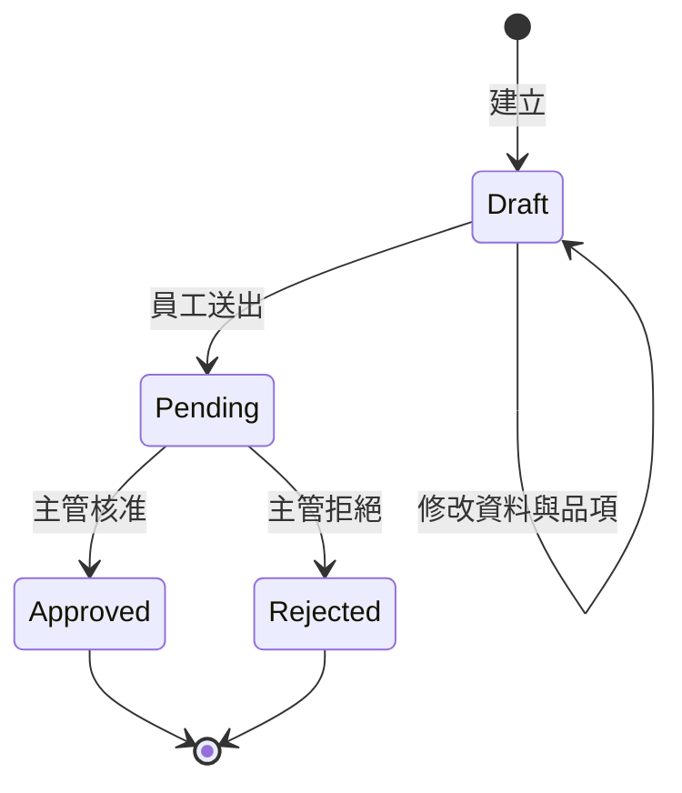
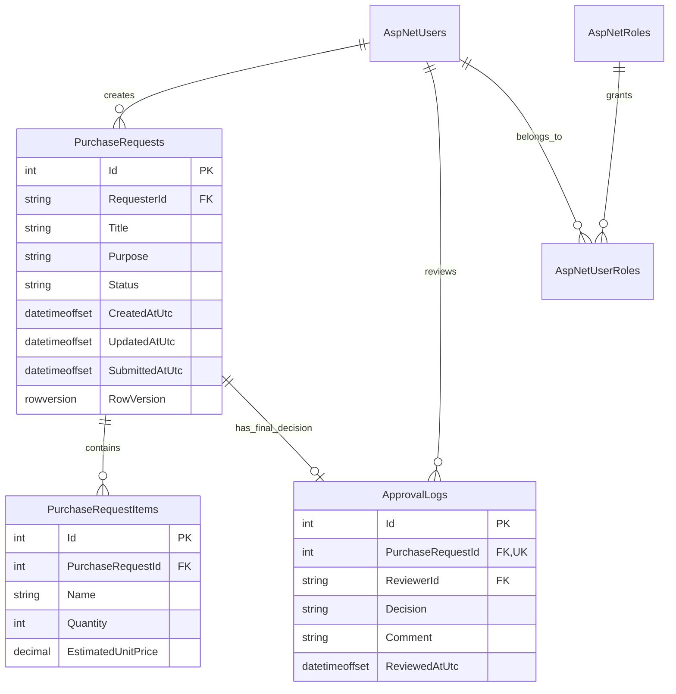

# PurchaseFlow — MVP 需求與資料設計

> 狀態：**已確認 v1.0.1（文件釐清）**｜2026-10-23｜適用範圍：第三個求職作品 PurchaseFlow。
> D1～D6 已由使用者確認；細部欄位長度等屬實作規格預設值，有必要調整時同步修訂 API 與測試。

## 1. 目標與邊界

### 1.1 目標

- 優先展示 C#、ASP.NET Core Web API、EF Core、SQL Server、Identity／Authorization、REST API、資料一致性及 xUnit 測試的實作能力。
- 次要展示具有可解釋業務規則的企業內部審核流程。
- 前端使用 Vue 3 + TypeScript；專注於可操作的完整流程，不追求大量頁面。

### 1.2 MVP 包含

- 登入／登出、角色權限及取得目前登入資訊。
- 員工建立、查看、修改採購草稿，新增或修改採購品項，送出審核。
- 主管查看待審核與已審核申請，查看明細，核准或拒絕。
- 在審核時保存操作者、時間、決定與必要的拒絕理由。
- 基本欄位驗證、標準化 API 錯誤、並行審核衝突處理、自動化測試。
- README、可啟動的 Demo／部署說明（部署平台在後期確認）。

### 1.3 MVP 不包含

- 公開註冊／使用者管理介面、組織架構、多層審核、退回與重送、通知、附件、供應商、詢價、庫存、採購付款、報表儀表板、微服務、訊息佇列。
- 不提供已送出申請的編修或刪除；不提供正式資料的硬刪除 API。

## 2. 角色與權限（已確認）

MVP 採兩種角色，單一帳號僅扮演一種角色；使用 ASP.NET Core Identity 的角色授權。這是縮小範圍的設計，不代表正式企業系統不能同時具備兩角色。

| 操作 | 員工 Employee | 主管 Manager |
|---|---:|---:|
| 登入／登出 | ✓ | ✓ |
| 建立／修改自己的 Draft | ✓ | — |
| 查看自己的所有狀態申請 | ✓ | — |
| 送出自己的 Draft | ✓ | — |
| 查看所有 Pending 及已審核申請 | — | ✓ |
| 核准／拒絕 Pending | — | ✓ |
| 查看可存取申請的審核紀錄 | ✓ | ✓ |
| 查看別人的 Draft | — | — |

- 員工永遠只能以登入者識別身分取得自己的資料；建立者 ID 由伺服器決定，不接受客戶端指定。
- 主管只可見已送出（Pending／Approved／Rejected）的申請，不能查看未送出的草稿。
- 頁面按角色隱藏操作僅屬 UX；每支 API 都要在後端檢查角色、所有權與狀態。
- 針對不允許查看的申請，回應 `404`，避免洩露其他員工的申請是否存在。角色不足則回應 `403`。

## 3. 狀態機與業務規則（已確認核心規則）

1. 新增申請即為 `Draft`。**「空草稿」是指可以沒有品項（0 項），不是指標題可為空；建立草稿時標題仍必填**。員工只能編輯自己的草稿。草稿不提供刪除 API。
2. 送審時必須有標題、至少 1 項有效品項；不可由前端提交總金額或任意指定狀態。
3. Pending 及最終狀態均不可編輯品項或標題。
4. 主管僅可對 Pending 進行一次核准／拒絕。拒絕必須提供原因（建議 1～500 字）；核准備註可不填。
5. `Approved`、`Rejected` 不可回退、重審或重送。
6. 主管決策必須同時更新申請狀態及新增一筆不可透過業務 API 修改的審核紀錄。任一步驟失敗，兩者都不得成功。
7. 若同時審核同一筆申請，只允許第一個成功提交者生效；其他請求回 `409 Conflict`。修改草稿、送審或審核均需檢查**客戶端最後取得的 rowVersion**，並使用資料庫並行控制避免兩請求競態；過期版本回 409。
8. 金額以 TWD 計，品項 `數量 × 預估單價`；總額由後端計算，不接受客戶端總額作為信任來源。不計算稅、運費、折扣。

### 3.1 基本欄位驗證（實作預設）

| 欄位 | 規則 |
|---|---|
| 申請標題 | 必填，去除首尾空白後 1～120 字 |
| 申請用途／說明 | 選填，最多 1,000 字 |
| 品項名稱 | 必填，去除首尾空白後 1～150 字 |
| 品項數量 | 正整數，1～999 |
| 預估單價 | `decimal(18,2)`，必須大於 0；禁止超出欄位精度 |
| 品項數 | 草稿 0～20；送審 1～20 |
| 拒絕理由 | 拒絕時必填，去除空白後 1～500 字 |
| 審核備註 | 核准時選填，最多 500 字 |

## 4. 資料庫設計（MVP v1）

使用 EF Core Migrations 管理 SQL Server Schema。使用者、角色及帳號安全相關資料由 ASP.NET Core Identity 管理，不自行設計密碼資料表。

**ERD 畫的是 SQL Server 真正儲存的資料表及欄位**。`TotalAmount`、`LineTotal` 為 API 回傳時由後端計算的值，並非資料表欄位，所以刻意不畫入 ERD；詳見 §4.2。`AspNetUsers`、`AspNetRoles`、`AspNetUserRoles` 為 Identity 管理的資料表，這張業務 ERD 只顯示它們與採購資料的必要關聯，省略 Identity 內建欄位。

### 4.1 核心業務關聯、刪除與完整性

| 關聯 | 刪除規則 | 理由 |
|---|---|---|
| `PurchaseRequests.RequesterId → AspNetUsers.Id` | Restrict / NoAction | 保留申請人與單據 |
| `PurchaseRequestItems.PurchaseRequestId → PurchaseRequests.Id` | Cascade（僅資料庫內部） | 品項依附主單；正式 API 不允許硬刪除主單 |
| `ApprovalLogs.PurchaseRequestId → PurchaseRequests.Id` | Restrict / NoAction | 防止刪除已審核單據與紀錄 |
| `ApprovalLogs.ReviewerId → AspNetUsers.Id` | Restrict / NoAction | 保留審核人身份 |

> ERD 另外畫出 `AspNetUsers`／`AspNetRoles` 與 `AspNetUserRoles` 的兩條關聯。這是 **Identity 內建角色資料模型**，非自訂採購業務 FK，刪除規則由 Identity 的實際 Migration 管理；因此不納入上表四條採購業務 FK，建置時需核對 Migration。

- `ApprovalLogs.PurchaseRequestId` 設唯一索引，確保每份申請最多一筆最終決策紀錄。
- 狀態與決定使用明確的字串值及 SQL CHECK 條件（或等價的 DB 層限制）；數量大於 0、單價大於 0 亦加上檢查約束。
- `PurchaseRequests.RowVersion` 使用 SQL Server `rowversion` 並對應 EF Core concurrency token。每次修改草稿（即使只改品項）、送審或審核，都必須更新主單欄位（例如 `UpdatedAtUtc`），使主單 `rowversion` 改變。
- 時間使用 UTC（建議 C# `DateTimeOffset`），API 回應 ISO 8601 UTC 時間。
- 需要設計種子測試帳號，但不可把真實密碼／連線字串提交到 Git。

### 4.2 實體欄位與 API 計算值（避免混淆）

| 名稱 | 是否為 SQL Server 實體欄位 | 來源與用途 |
|---|---|---|
| `PurchaseRequestItems.Quantity` | **是** | 使用者輸入的品項數量（正整數） |
| `PurchaseRequestItems.EstimatedUnitPrice` | **是** | 單價，SQL Server `decimal(18,2)` |
| `LineTotal`（API `lineTotal`） | **否** | 後端計算 `Quantity × EstimatedUnitPrice`，不另儲存 |
| `TotalAmount`（API `totalAmount`） | **否** | 後端加總該申請所有品項的 `LineTotal`，不另儲存 |
| `PurchaseRequests.RowVersion`（API `rowVersion`） | **是** | SQL Server `rowversion`；API 以 Base64 字串傳遞供並行版本檢查 |

因此，**`totalAmount` 出現在 API JSON 並不表示 `PurchaseRequests` 有 `TotalAmount` 欄位**。後端從 SQL Server 的品項資料讀取並計算，前端不可提交或修改權威金額；若品項為 0，總額為 `0.00`。在實作時需檢查計算總額的精度及可表示範圍，避免超額輸入或算術溢位。

本節只釐清原本的設計，**沒有新增資料庫欄位或變更已確認 D1～D6 決策**。

## 5. 主要畫面（四個頁面模板）

1. `/login`：登入頁；不提供註冊。
2. `/requests`：申請清單。員工顯示「我的申請」；主管使用同一模板的「待審核／已審核」分頁。
3. `/requests/new`、`/requests/:id/edit`：共用採購申請編輯模板，只允許建立或修改 Draft。
4. `/requests/:id`：申請明細，員工可查看結果，主管可核准／拒絕並查看審核紀錄。

前端須處理載入中、空列表、欄位錯誤、401（導回登入）、403／404、409（提示重新載入）。所有操作必須以 API 的實際授權與狀態為準。

## 6. 本階段確認的設計決策

| 編號 | 已確認決策 |
|---|---|
| D1 | 每帳號單一角色：Employee／Manager |
| D2 | Identity + Cookie、同源部署、CSRF、不開放公開註冊 |
| D3 | 草稿可為空，送審至少一項，不提供刪除申請 |
| D4 | 拒絕必填理由；核准備註選填；一筆最終審核 |
| D5 | TWD、`decimal(18,2)`，總額由後端計算 |
| D6 | SQL Server `rowversion` + HTTP 409，審核交易原子性與唯一紀錄 |

其他技術與部署方式見 [`PLAN.md`](PLAN.md)，端點與錯誤格式見 [`API.md`](API.md)。
